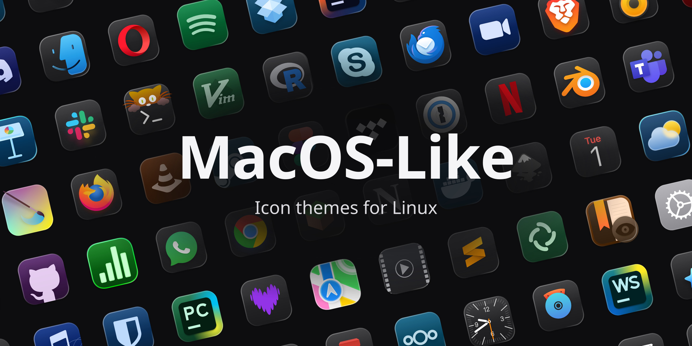
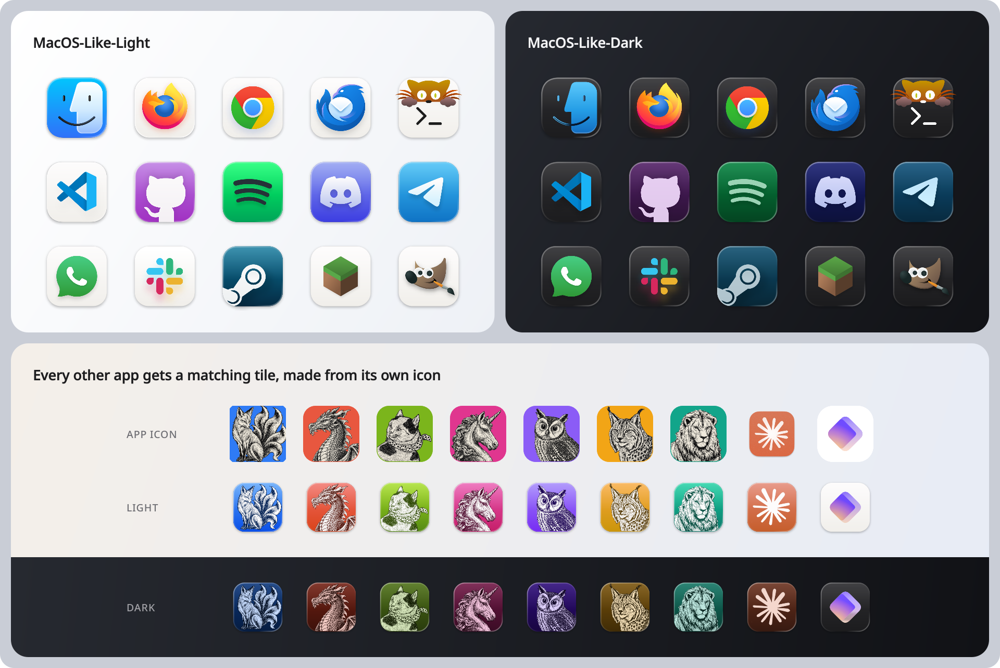

macOS Tahoe icons for every app on your Linux desktop, in light and dark, for
KDE Plasma and GTK desktops (GNOME, Cinnamon, MATE, Xfce, ...).

MacOS-Like builds two icon themes, **MacOS-Like-Light** and **MacOS-Like-Dark**,
from [MacTahoe](https://github.com/vinceliuice/MacTahoe-icon-theme). Every tile
gets the same shadow, edge and shade, the dark theme gets real dark tiles, and
apps MacTahoe has no artwork for get a matching tile made from their own icon.
MacTahoe comes with it, so there is nothing else to install.

## Install

```sh
curl -fsSL https://raw.githubusercontent.com/Scrimas/MacOS-Like/main/install.sh | bash
```

It asks before installing the few packages it needs (Python 3 with Pillow, and
`rsvg-convert`), builds both themes into `~/.local/share/icons` in under a
minute, offers to switch your icons, and adds the `macos-like` command. Add
options after `bash -s --`: `--light` or `--dark` to switch without asking,
`--no-apply` to leave your icons alone, `--yes` to answer yes to everything.

From a clone, `./install.sh` does the same, using the clone.



## Use

```sh
macos-like refresh          # after installing apps: gives them tiles
macos-like update           # get the latest MacOS-Like and rebuild
macos-like apply dark       # or light
macos-like folders purple   # blue green grey nord orange purple red yellow, '#rrggbb', matugen, reset
macos-like uninstall        # puts your previous icon theme back
```

`folders matugen` makes the folders follow your wallpaper's palette with
[matugen](https://github.com/InioX/matugen).

## Customize

Settings live in `~/.config/macos-like` and apply on the next
`macos-like refresh`. Don't edit the themes themselves: every build starts them
afresh.

- **Your own artwork for an app**: `overrides.conf`, lines like
  `ryujinx=/usr/share/pixmaps/ryujinx.svg`, where the name is the app's `Icon=`
  value ([example](overrides.conf.example)).
- **Keep an app's dark tile in the light theme**: `keep-dark.conf`, one `Icon=`
  name per line ([example](keep-dark.conf.example)).
- **Other fallback themes** for icons MacTahoe lacks entirely (default: the
  first of breeze-plus, breeze, Papirus and Adwaita you have):
  `macos-like refresh -- --inherits-dark Papirus-Dark,hicolor` (or
  `--inherits-light`).

## Credits and license

Built on [MacTahoe](https://github.com/vinceliuice/MacTahoe-icon-theme) by
vinceliuice (GPL-3.0), which ships unmodified in `vendor/`; `prebuilt/` holds
modified versions of its icons. Generated tiles use each app's own icon.
MacOS-Like is [GPL-3.0-or-later](LICENSE).

To move to a newer MacTahoe, change the commit pinned in
`tools/update-mactahoe.sh` and run it. The images above come from
`python3 screenshots/render.py`.
